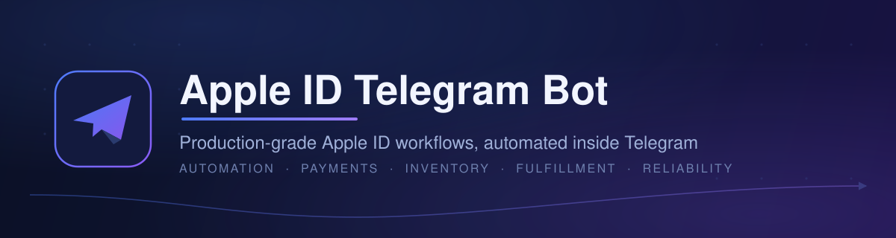
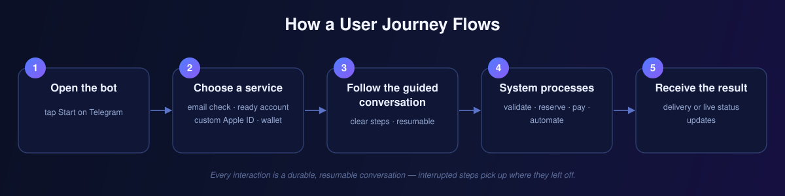
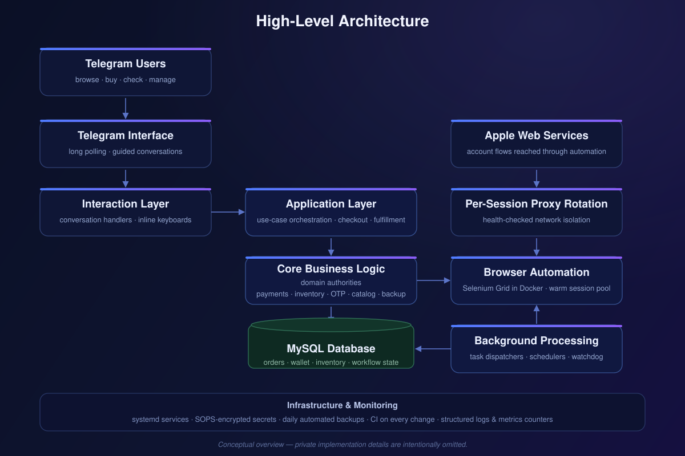

  <a href="README.md">🇬🇧 English</a> · <strong>🇮🇷 فارسی</strong>

  

  # Apple ID Telegram Bot

  **پلتفرم تلگرامیِ عملیاتی برای فرایندهای Apple ID — بررسی ایمیل، سفارش، پرداخت، موجودی و تحویل خودکار حساب.**

  

  
  
  

  **وضعیت:** فعال در محیط عملیاتی · توسعه از سپتامبر ۲۰۲۵ · آخرین فعالیت نوامبر ۲۰۲۶

## چه کاری انجام می‌دهد؟

ربات، کارهای چندمرحله‌ای Apple ID را به گفت‌وگوهای راهنمادار و قابل ادامه در تلگرام تبدیل می‌کند. کاربر می‌تواند:

- **دسترس‌پذیری ایمیل** را برای ثبت‌نام Apple ID بررسی کند — با محدودیت درخواست، کش و کنترل سوءاستفاده
- **حساب آماده** بخرد — با رزرو موجودی و جلوگیری از فروش هم‌زمان یک حساب
- **حساب شخصی‌سازی‌شده سفارش دهد** — ساخته‌شده از طریق فرایندهای خودکار و تأییدشده
- **با کیف پول یا رسید پرداخت کند** — با پرداختِ مقاوم در برابر تکرار و تأیید مدیر
- **همه مراحل را زنده دنبال کند** — تأیید OTP، وضعیت سفارش و اطلاع‌رسانی تحویل
- **از وقفه عبور کند** — عملیات قابل ادامه، پشتیبان‌گیری روزانه و بازیابی اعتبارسنجی‌شده

رابط کاربری کاملاً فارسی است.

## مسیر کاربر

1. وارد [t.me/Theappleidbot](https://t.me/Theappleidbot) شوید و Start را بزنید.
2. سرویس موردنظر را از منو انتخاب کنید.
3. در گفت‌وگوی راهنمادار پیش بروید — هر مرحله اعتبارسنجی می‌شود.
4. سامانه درخواست را اعتبارسنجی می‌کند و در صورت لزوم، پیش از اجرای اتوماسیونِ موردنیاز، پرداخت را بررسی و موجودی را رزرو می‌کند.
5. حساب یا وضعیت شفاف هر مرحله را دریافت می‌کنید.

## معماری

معماری لایه‌ای با جهت وابستگیِ اجباری: هندلرهای تلگرام گفت‌وگوها را تحویل می‌دهند، سرویس‌های لایه کاربرد فرایندها را هماهنگ می‌کنند و مرجع‌های دامنه (domain authorities) قواعد پرداخت، موجودی، OTP، کاتالوگ و پشتیبان‌گیری را حفظ می‌کنند — با پشتیبان MySQL، اتوماسیون مرورگر در Docker با استخر نشست‌های آماده و پردازش پس‌زمینه. عملیات روی Linux با systemd، تنظیمات رمزنگاری‌شده با SOPS و پشتیبان‌گیری روزانه اجرا می‌شود.

پشتیبانی پروکسی به‌صورت اختیاری در کد وجود دارد، اما در محیط عملیاتی فعلی **غیرفعال** است (تأییدشده در ۳ نوامبر ۲۰۲۶).

توضیح کامل‌تر: [docs/ARCHITECTURE.md](docs/ARCHITECTURE.md).

## نکات مهندسی

- **نشست‌های آماده مرورگر که قابل‌اعتماد ماندند.** یک تعارض پیکربندی اولین نشست آماده را از کار می‌انداخت و بررسی ایمیل را به چند دقیقه کش می‌داد → اصلاح تعارض، بارگذاری eager و تلاش مجدد در همان نشست، جایگزینی پس‌زمینه → نشست‌های آماده قابل‌اعتماد، همراه با بنچمارک قابل تکرار برای اندازه‌گیری.
- **راه‌اندازی مجدد که به کار فعال احترام می‌گذارد.** گیتِ راه‌اندازی مجدد سیگنال‌هایی را بررسی می‌کرد که هرگز نوشته نمی‌شدند؛ نتیجه: قطع کارها یا رد شدن همیشگی از راه‌اندازی مجدد → بررسی فقط سیگنال‌های واقعی، کنار گذاشتن رزروهای یتیم و محدود کردن زمان انتظار → راه‌اندازی مجدد منتظر بیکار شدن واقعی سامانه می‌ماند و اگر انتظار از سقف مجاز بگذرد، به‌صورت کنترل‌شده اجباری می‌شود تا استقرار برای همیشه متوقف نماند.
- **از منطق ثابت به کاتالوگ واقعی.** افزودن هر محصول جدید نیازمند تغییر در مسیرهای قیمت‌گذاری، پرداخت، موجودی و تحویل بود → کاتالوگ پایدار بر اساس نوع محصول، حفظ قیمت‌گذاری در مرجع خودش، fallback های fail-closed و اسنپ‌شات یک‌بارنویس سفارش‌ها → تغییرات اسکیما فقط افزودنی و قیمت‌گذاری تاریخی تغییرناپذیر.

روایت کامل با جزئیات بررسی: [docs/ENGINEERING_HIGHLIGHTS.md](docs/ENGINEERING_HIGHLIGHTS.md).

## فناوری و کیفیت

**فناوری‌ها:** Python 3.12 · python-telegram-bot 22.8 · MySQL/MariaDB · Selenium Grid در Docker (استخر نشست آماده) · OpenPyXL/pandas · pytest · GitHub Actions · Linux + systemd · SOPS (age).

مجموعه گسترده‌ای از تست‌های pytest — واحد، یکپارچه و مبتنی بر پایگاه داده برای صحت پرداخت، رزرو موجودی و پشتیبان‌گیری/بازیابی — به‌عنوان گیت CI روی هر push اجرا می‌شود و PRهای خودکار فقط بعد از گذراندن کامل CI روی همان کامیت ادغام می‌شوند. آخرین اجرای CI روی شاخه اصلی (۷ نوامبر ۲۰۲۶) موفق بوده است.

جزئیات، آمار مقیاس و روش شمارش: [docs/TESTING_AND_QUALITY.md](docs/TESTING_AND_QUALITY.md) · [docs/DEVELOPMENT_TIMELINE.md](docs/DEVELOPMENT_TIMELINE.md).

## مستندات پروژه

| سند | محتوا |
|---|---|
| [قابلیت‌ها](docs/FEATURES.md) | شرح عمومی و امن قابلیت‌ها |
| [معماری](docs/ARCHITECTURE.md) | معماری مفهومی و اصول طراحی |
| [نکات مهندسی](docs/ENGINEERING_HIGHLIGHTS.md) | روایت کامل فنی چالش‌ها |
| [مسیر توسعه](docs/DEVELOPMENT_TIMELINE.md) | نقاط عطف تأییدشده، فعالیت و آمار مقیاس پروژه |
| [تست و کیفیت](docs/TESTING_AND_QUALITY.md) | راهبرد تست و شواهد CI |
| [حریم خصوصی و امنیت](docs/PRIVACY_AND_SECURITY.md) | مرزهای انتشار و مدیریت اسرار |
| [پرسش‌های متداول](docs/FAQ.md) | سؤال‌های رایج |

## انتساب و سلب مسئولیت

- **توسعه با کمک هوش مصنوعی، با هدایت انسانی.** ایجنت‌های هوش مصنوعی طراحی‌های بازبینی‌شده را پیاده‌سازی و خطاها را تحلیل کرده‌اند؛ تصمیم‌های معماری، بازبینی، یکپارچه‌سازی و اعتبارسنجی بر عهده صاحب پروژه است. نه اجرای بی‌نظارت، نه کدِ کاملاً دستی — یک فرایند مهندسی آگاهانه با گیت CI.
- **پروژه‌ای مستقل.** هیچ وابستگی یا تأییدی از سوی Apple Inc. ندارد. Apple، Apple ID و نشان‌های مرتبط، علامت‌های تجاری Apple Inc. هستند. دسترس‌پذیری سرویس ممکن است تغییر کند.
- **فقط نمایشگاه.** پیاده‌سازی عملیاتی، پیکربندی و داده‌های عملیاتی در مخزن خصوصی می‌مانند؛ این مخزن عمداً شامل کد تولیدی، اسرار یا داده کاربران نیست.

---

**ساخته و نگهداری‌شده توسط [Imanemoon](https://github.com/Imanemoon)**

