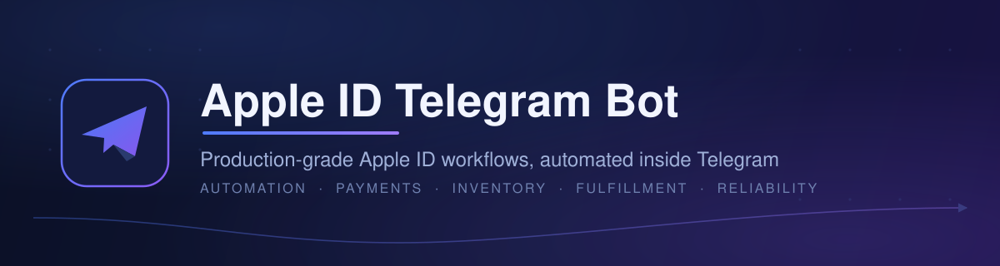
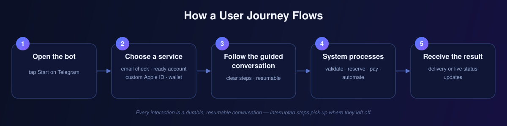
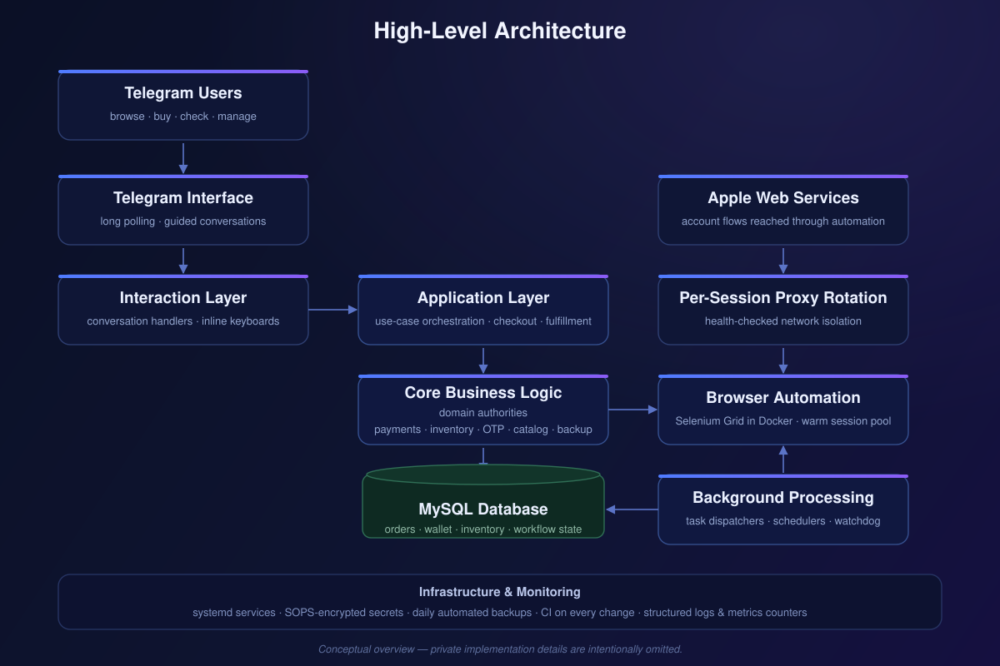
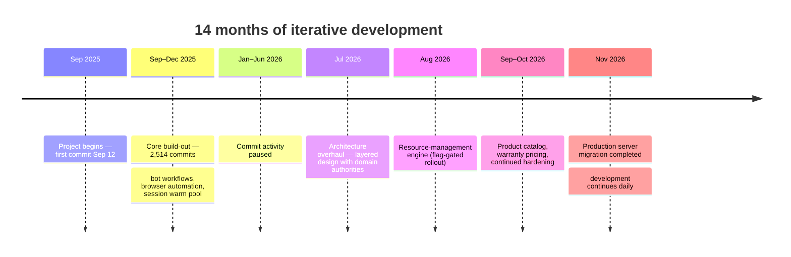

  <a href="README.fa.md">🇮🇷 فارسی</a> · <strong>🇬🇧 English</strong>

  <a href="README.fa.md">🇮🇷 فارسی</a> · <strong>🇬🇧 English</strong>

  

  # Apple ID Telegram Bot

  **Production-grade Apple ID workflows, automated inside Telegram.**

  A real, running product: a Telegram-native platform for Apple ID account creation,
  email availability checks, orders, payments, inventory, fulfillment, and recovery —
  engineered for reliability, tested continuously, and operated in production.

  

  **Status:** Production · actively developed since September 2025 · latest development activity November 2026

  
  
  
  
  
  

  **Independent project — not affiliated with or endorsed by Apple Inc.**

---

> [!TIP]
> ### Try the Telegram Bot → [@Theappleidbot](https://t.me/Theappleidbot)
> Open the bot, tap **Start**, and pick a service. The bot walks users through each
> workflow with guided conversations — checking email availability, buying a ready
> Apple ID, ordering a personalized one, or managing a wallet. *(Bot username verified
> live on November 7, 2026.)*

## Product Overview

This repository is the **public showcase** for a production-oriented Telegram platform
that automates Apple ID workflows end to end. The production implementation is private;
this showcase documents the product, its architecture at a conceptual level, and the
engineering behind it.

- **What it does.** Users interact with a Telegram bot to check whether an email is
  available for Apple ID registration, purchase ready-made Apple IDs, order
  personalized accounts, top up a wallet, and receive accounts through automated,
  verified delivery workflows.
- **The problem it solves.** Apple ID creation and verification is a slow,
  multi-step, error-prone process when done by hand at scale. The platform turns it
  into a guided, resumable conversation with inventory reservations, payment
  safeguards, and automated account delivery.
- **Who it is for.** Persian-speaking Telegram users who want Apple accounts without
  manual paperwork — the entire user interface is localized in Persian (Farsi) —
  plus a full administration surface for the operator.
- **Why Telegram.** No app install, no website: conversations, inline keyboards,
  receipts, and status updates all live in the messenger people already use.

## Core Features

| | Feature | What it delivers |
|---|---|---|
| 🔎 | **Email availability checks** | Fast checks of whether an email can be used for Apple ID registration, with tiered rate limits, caching, and abuse protection |
| 🆕 | **Apple ID creation & management** | Automated, guided creation of personalized Apple IDs with verification built into the flow |
| 📦 | **Ready-account storefront** | Instant delivery of prepared accounts from managed stock |
| 🎨 | **Personalized-account orders** | Custom accounts created to the buyer's specification through an automated pipeline |
| 🗃️ | **Inventory & reservations** | Stock tracking with reservation semantics so two buyers can never claim the same account |
| 🧾 | **Orders & fulfillment** | Order lifecycle from checkout through delivery, with receipt-based and wallet-based payment paths |
| 💳 | **Wallet & payments** | Stored balance, top-ups, refunds, and admin-reviewed approvals with integrity safeguards |
| 🔐 | **OTP verification** | One-time-code capture and delivery as part of automated account workflows |
| 🛡️ | **User & admin management** | Admin panels, support tickets, broadcasts, bans, and configurable permissions |
| 🏷️ | **Catalog, promos & warranties** | Persistent product catalog, discount coupons, promotions, and warranty options |
| 📊 | **Reporting & Excel exports** | Operational and inventory reporting with Excel export support |
| 🔁 | **Failure recovery & backups** | Resumable interrupted operations, watchdog monitoring, daily automated database backups, and a validated restore flow |

A detailed, public-safe breakdown lives in [docs/FEATURES.md](docs/FEATURES.md).

## How It Works

1. **Open the bot** on Telegram and tap *Start*.
2. **Choose a service** — email check, ready account, personalized account, wallet, and more.
3. **Follow the guided conversation** — every step is validated, and progress is durable.
4. **The system processes the request** — inventory is reserved, payments are checked, and browser automation performs the account work where required.
5. **The user receives the result** — account delivery or clear status updates at every stage.

## High-Level Architecture

The system is organized as a **layered architecture with enforced dependency
direction**: a delivery layer (Telegram handlers) on top, an application layer
coordinating use cases in the middle, and a core of domain authorities owning
payments, inventory, OTP, catalog, and backup logic — backed by a MySQL database,
Dockerized browser automation with a warm session pool, per-session proxy rotation,
and background task processing. Operations run on Linux under systemd with
SOPS-encrypted secrets, daily automated backups, and CI on every change.

A conceptual walkthrough is in [docs/ARCHITECTURE.md](docs/ARCHITECTURE.md).
Implementation details, database schemas, and internal interfaces are intentionally
not published.

## Technology Stack

| Layer | Technology |
|---|---|
| Language | Python 3.12.16 (production runtime, verified November 3, 2026) |
| Bot framework | python-telegram-bot 22.8 — long polling, job queue |
| Database | MySQL / MariaDB |
| Browser automation | Selenium + Dockerized Selenium Grid (Chrome), warm session pool |
| Proxy integration | Optional per-session proxy support in the codebase; disabled in the current production runtime |
| Reporting | OpenPyXL, pandas |
| Testing | pytest — 7,193 test functions across 538 test files |
| CI/CD | GitHub Actions — automated PR validation on every change |
| Deployment | Linux, systemd services, Docker |
| Secrets | SOPS with age encryption — no plaintext secrets in Git |

## Engineering Highlights

| Area | Engineering approach |
|---|---|
| **Modular architecture** | Layered design with a one-way dependency rule: delivery → application → core, so business rules never depend on Telegram |
| **Durable workflows** | Conversation state survives restarts; interrupted operations resume where they left off |
| **Idempotent payments** | A dedicated payment authority makes approvals and debits safe to retry; a focused integrity suite guards the invariants |
| **Reservation consistency** | Inventory reservations with lease/expire semantics and database-level guards against double-claiming |
| **Session lifecycle** | Warm browser pool with background refill, watchdog monitoring, and orphan cleanup keeps automation responsive |
| **Fault recovery** | Resumable OTP waits, bounded retries, and post-restore database validation |
| **Observability** | Structured logging with secret redaction plus production metrics counters |
| **Safe operations** | Idle-gated restarts, daily backups with retention, staged restore with typed confirmations |

The full narratives — including the investigation behind each one — are in
[docs/ENGINEERING_HIGHLIGHTS.md](docs/ENGINEERING_HIGHLIGHTS.md).

## Project Scale & Verified Metrics

**As of November 7, 2026** — all figures recomputed from the project's `main` branch.

| Metric | Value |
|---:|---|
| Total commits (main branch) | **3,748** |
| Development window | Sep 12, 2025 → Nov 7, 2026 (~14 months) |
| Remote branches (historical) | 447 |
| Tracked files | 893 |
| Python files | 729 — **191 production** + **538 test** |
| Production Python code | **179,373 lines** |
| Test code | **175,328 lines** |
| Test functions | **7,193** |
| Documentation (Markdown) | 110 files |
| Latest CI run on main | ✅ success (Nov 7, 2026) |

<strong>Counting methodology</strong>

- Commits, branches, and file counts come from `git rev-list` / `git ls-tree` on the full `main` history.
- "Production" = tracked `.py` files that are not test files; "test" = tracked files matching `test_*.py`.
- Line counts are physical lines (`wc -l`) across the tracked Python files in each category: production `.py` files and test `test_*.py` files. Non-Python files are not included.
- Test-function count = occurrences of `def test_` across all tracked test files.
- Branch count is a historical development-activity metric, not a statement about current branches.

## Development Journey

- **Sep–Dec 2025** — the product took shape fast: 2,514 commits in four months, including the browser-automation core and the warm session pool (introduced December 10, 2025).
- **Jan–Jun 2026** — the repository shows no commits in this window. It is reported transparently as a development pause rather than speculated about.
- **Jul 2026** — work resumed with a deliberate architecture overhaul: a layered design with domain authorities for payments, inventory, OTP, and more, enforced through documented architecture decisions.
- **Aug–Oct 2026** — a flag-gated resource-management engine, a persistent product catalog, a reworked warranty pricing model, and continued reliability hardening.
- **Nov 2026** — a full production-server migration was completed and recorded (November 3), and daily development continues (latest commit November 7, 2026).

## Challenges Solved

Selected from real project history. Each is presented as **Challenge → Engineering Approach → Outcome**, with implementation specifics kept private.

| Challenge | Engineering approach | Outcome |
|---|---|---|
| **First warm browser slot kept dying**, stretching email checks toward minutes | Fixed a flag conflict that disabled the very extension being loaded; added renderer-stability options and eager page loads; soft-retried navigation inside the live session; refilled idle slots in the background | Warm slots became dependable, with a repeatable instrumented bench harness to measure warm-up behavior |
| **New browser sessions queued for minutes** behind hung ones | Instrumented per-phase timings to isolate the queue; force-released remote sessions whose cleanup hung; bypassed proxy handling for local connections | Session creation dropped from multi-minute queueing to sub-second in follow-up measurements |
| **Deploy restarts raced live work** — interrupting jobs or never happening | Replaced dead probes with real runtime signals (busy workflows, leased slots), excluded orphaned leases in SQL, and bounded the wait with an injected clock | Restarts happen only when provably idle — with a forced-restart safety bound so updates can never stall forever |
| **Unexplained authentication failures** with no usable logs | Built scrubbed in-page request capture for the exact failing endpoints, split into a pure redaction/format half (unit-testable without a browser) and a browser hook under a strict never-log contract | Privacy-safe, actionable diagnostics — with the root cause explicitly left undetermined rather than guessed |
| **Hardcoded product logic** made every new product a cross-cutting change | Introduced a persistent catalog keyed by product type, kept pricing with its own authority, and used fail-closed legacy fallbacks plus write-once order snapshots | Additive-only schema changes and immutable historical pricing on every order |
| **Server-to-server production migration** without data loss | Automated host bootstrap (packages, secrets materialization, database import, health checks), staged dump/restore with typed confirmations, and post-restore validation | Migration completed and recorded in November 2026 |

More cases and the investigation details: [docs/ENGINEERING_HIGHLIGHTS.md](docs/ENGINEERING_HIGHLIGHTS.md).

## Testing & Quality

- **7,193 test functions** across 538 test files — unit, integration, and database-backed suites.
- Dedicated suites guard the highest-risk invariants: payment integrity, session pooling, backup retention, and restore validation.
- **GitHub Actions** runs a regression gate on every push; automated PRs merge only after CI passes on the exact change.
- The latest CI run on `main` (November 7, 2026) is **green**. Test execution results are reported only from verified runs — no unverified pass claims are made.

Details: [docs/TESTING_AND_QUALITY.md](docs/TESTING_AND_QUALITY.md).

## AI-Assisted Engineering Workflow

This project was built with a **deliberate AI-assisted engineering workflow** — used as a force multiplier under technical direction, not as an autopilot:

- **Workstream decomposition.** Large goals are broken into manageable workstreams with explicit scope and acceptance criteria.
- **AI agents for implementation and investigation.** Coding agents implement reviewed designs; investigation agents dig through logs, history, and failure modes.
- **Human direction and review.** Architectural decisions, review, and integration are owned by the project author; changes are validated before they land.
- **Regression discipline.** Every workstream lands with tests — bug fixes land with regression witnesses.
- **CI-gated automation.** An automated PR flow creates and merges changes only after the full CI run passes on the exact commit.
- **Attribution honesty.** The project keeps an internal evidence dossier distinguishing directly authored work from AI-co-authored implementation — a discipline this showcase inherits by not overclaiming.

## Getting Started

1. Open **[t.me/Theappleidbot](https://t.me/Theappleidbot)** in Telegram.
2. Tap **Start** and pick a service from the menu.
3. Follow the guided conversation — the interface is in Persian (Farsi).

The production deployment is operated privately; this repository intentionally contains no server installation or configuration instructions.

## Documentation

| Document | Contents |
|---|---|
| [Features](docs/FEATURES.md) | Public-safe feature breakdown |
| [Architecture](docs/ARCHITECTURE.md) | Conceptual architecture and design principles |
| [Engineering Highlights](docs/ENGINEERING_HIGHLIGHTS.md) | Challenges, approaches, and verified outcomes |
| [Development Timeline](docs/DEVELOPMENT_TIMELINE.md) | Verified milestones and activity |
| [Testing & Quality](docs/TESTING_AND_QUALITY.md) | Test strategy and CI evidence |
| [Privacy & Security](docs/PRIVACY_AND_SECURITY.md) | What is and isn't public, and how secrets are handled |
| [FAQ](docs/FAQ.md) | Common questions |

## Disclaimer & Privacy

- This is an **independent project**. It is **not affiliated with, endorsed by, or connected to Apple Inc.** in any way. Apple, Apple ID, and related marks are trademarks of Apple Inc.
- **Service availability may change.** Features, delivery times, and availability depend on operational conditions and are not guaranteed.
- **Share information thoughtfully.** The bot only asks for what a chosen workflow requires (for example, an email or account preferences). Do not send sensitive information the bot does not explicitly request for the workflow you selected.
- **This is a showcase.** The production implementation, configuration, and operational data remain private. No production source code, secrets, or user data are included in this repository — see [docs/PRIVACY_AND_SECURITY.md](docs/PRIVACY_AND_SECURITY.md).

---

**Built and maintained by [Imanemoon](https://github.com/Imanemoon)**
*Developed iteratively with AI-assisted engineering workflows and technical supervision.*

