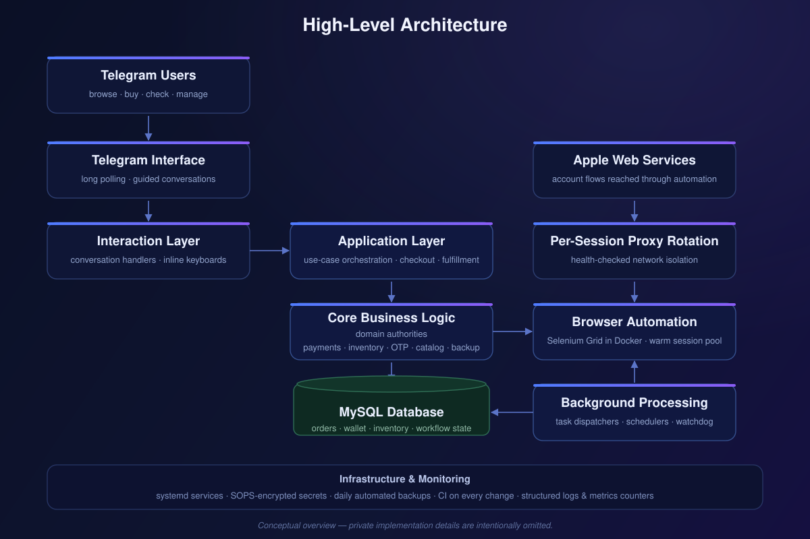
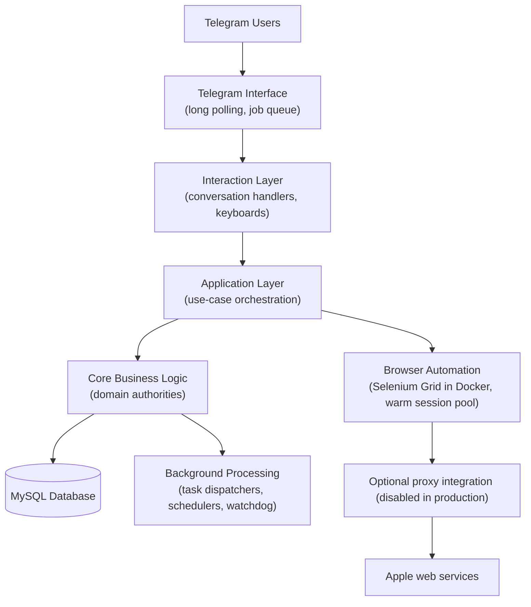

# Architecture

A conceptual description of how the system is organized. This document avoids
implementation details: no database schemas, internal interfaces, file layouts,
or configuration. Those remain private.

## The layers

The system follows a **layered architecture with an enforced dependency direction**:

**Interaction layer.** Telegram handlers translate user messages, callbacks, and
inline keyboards into calls against the application layer. Handlers contain no
business rules — they deliver conversations.

**Application layer.** Use-case services orchestrate complete workflows: checkout,
fulfillment, payment review, backup/restore, delivery panels, and reconciliation.
They coordinate core authorities without touching Telegram specifics.

**Core business logic.** Domain authorities own the invariants: payments, inventory
reservations, OTP verification, coupons, the product catalog, and backup/restore
storage. Business rules live here — and depend on nothing above them.

**Delivery adapters.** A single entry point runs long polling with a job queue for
scheduled work.

## Cross-cutting subsystems

- **Browser automation.** A Dockerized Selenium Grid drives real browser sessions.
  A warm session pool keeps pre-navigated sessions ready so user-facing operations
  start fast, with background refill, in-session soft retries, and a watchdog for
  process health.
- **Network isolation.** Each automation session can run through its own proxied
  connection, with health checks and cleanup of orphaned resources.
- **Background processing.** Task dispatchers, schedulers, and queueing decouple
  long-running automation from the interactive conversation.
- **Durability.** Conversation workflow state is persisted so interrupted
  operations resume instead of restarting; operations carry lease/expire semantics
  so crashes cannot wedge the system.

## Design principles

1. **Business rules at the center.** Telegram is a delivery detail; the domain
   authorities would work unchanged behind a different front end.
2. **Fail closed.** When compatibility or validation is uncertain, the system
   refuses rather than guesses.
3. **Everything resumable.** Long workflows checkpoint their state; interrupted
   operations are recoverable by design, not by heroics.
4. **Consistency over convenience.** Payments are idempotent, inventory is
   reserved with lease semantics, and order records are written once and
   frozen — historical records never mutate.
5. **Observability first.** Structured logging with secret redaction, production
   metrics counters, and scrubbed diagnostic capture for external failures.
6. **Operations as code.** systemd services, automated backups with retention,
   bootstrap automation for new hosts, and an idle-gated restart system for
   deploys.
