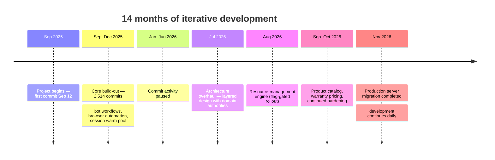

# Development Timeline

All dates below are derived from the project's Git history on `main` and are
verified as of **November 7, 2026**. Private branch names and commit messages
are intentionally not published; milestones are dated from when the relevant
capability first appears in history.

## Overview

| | |
|---|---|
| First commit | **September 12, 2025** |
| Latest commit | **November 7, 2026** |
| Development window | ~14 months |
| Total commits (main) | 3,748 |
| Months with commits | 9 of 14 |

## Commit activity by month

| Month | Commits | Phase |
|---|---:|---|
| Sep 2025 | 929 | Project start; rapid build-out begins |
| Oct 2025 | 547 | Core workflows |
| Nov 2025 | 585 | Core workflows |
| Dec 2025 | 453 | Warm session pool introduced (Dec 10) |
| Jan–Jun 2026 | 0 | Commit activity paused |
| Jul 2026 | 161 | Architecture overhaul begins |
| Aug 2026 | 341 | Resource-management engine |
| Sep 2026 | 386 | Product catalog & pricing |
| Oct 2026 | 308 | Hardening |
| Nov 2026 | 38 | Production migration; ongoing work |
| **Total** | **3,748** | |

## Milestones

| Date | Milestone |
|---|---|
| Sep 12, 2025 | First commit; the product's core conversations and automation take shape |
| Sep–Dec 2025 | 2,514 commits in four months: purchase workflows, wallet and payments, browser automation, inventory, administration |
| Dec 10, 2025 | Warm browser-session pool introduced for fast, reusable automation sessions |
| Jan–Jun 2026 | No commits — reported transparently as a development pause |
| Jul 26, 2026 | Layered architecture overhaul: domain authorities for payments, inventory, OTP, and more, with a documented decision record and enforced layering |
| Aug 1, 2026 | Resource-management engine introduced behind a feature flag |
| Sep 11, 2026 | Persistent product catalog (pricing authority preserved, fail-closed legacy fallbacks) |
| Sep–Oct 2026 | Warranty pricing consolidated into a single coherent model; continued reliability hardening |
| Nov 3, 2026 | Production server migration completed and recorded |
| Nov 7, 2026 | Ongoing development: pricing overrides and continued refinement |

## A note on the gap

The repository shows no commits between January and June 2026. This is stated
as what the history shows — a pause in committed work — without speculation
about causes. Development resumed in July 2026 with an architecture-focused
phase rather than a continuation of the prior code structure.

## Project Scale & Verified Metrics

**As of November 7, 2026** — all figures recomputed from the project's `main`
branch. These are scale measurements of the repository, not indicators of
quality or complexity on their own.

| Metric | Value |
|---:|---|
| Total commits (main branch) | **3,748** |
| Development window | Sep 12, 2025 → Nov 7, 2026 (~14 months) |
| Remote branches (historical) | 447 |
| Tracked files | 893 |
| Python files | 729 — **191 production** + **538 test** |
| Production Python code | **179,373 lines** |
| Test code | **175,328 lines** |
| Test functions | **7,193** |
| Documentation (Markdown) | 110 files |
| Latest CI run on main | ✅ success (Nov 7, 2026) |

### Counting methodology

- Commits, branches, and file counts come from `git rev-list` / `git ls-tree` on the full `main` history.
- "Production" = tracked `.py` files that are not test files; "test" = tracked files matching `test_*.py`.
- Line counts are physical lines (`wc -l`) across the tracked Python files in each category: production `.py` files and test `test_*.py` files. Non-Python files are not included.
- Test-function count = occurrences of `def test_` across all tracked test files — this is a source-pattern count, not a pytest-collected test count.
- Branch count is a historical development-activity metric, not a statement about current branches.

